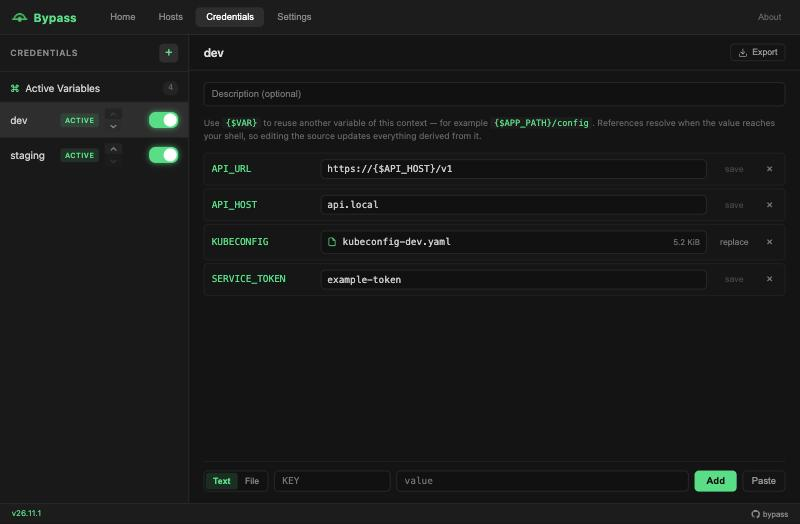
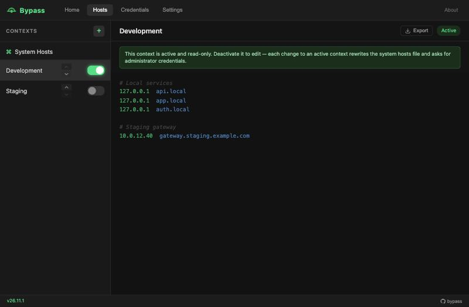
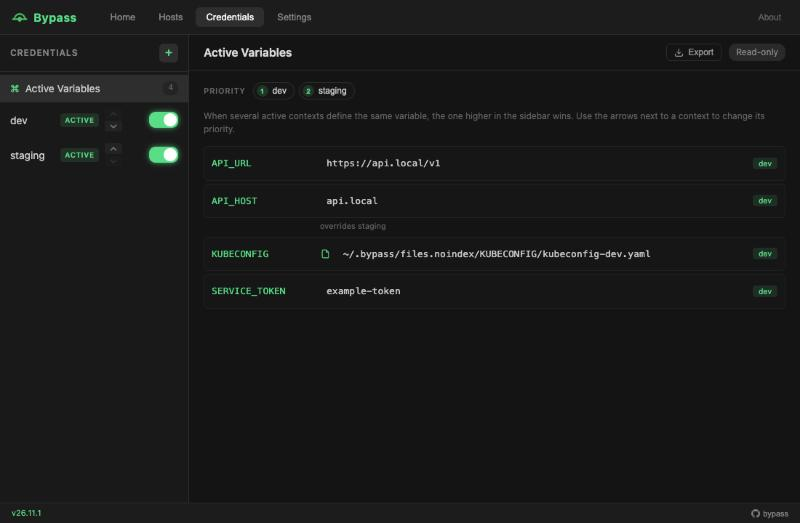

<p align="center">
  
</p>

<h1 align="center">Bypass</h1>

<p align="center">
  Switch hosts entries and environment variables per project on macOS, without editing <code>/etc/hosts</code> or keeping <code>.env</code> files around.
</p>

<p align="center">
  
</p>

## Features

- **Hosts contexts**: group hosts entries and turn them on or off with one click. Your own entries in `/etc/hosts` are never touched.
- **Credential contexts**: keep environment variables in an encrypted vault and serve them to your shells. Several contexts can be active at once, layered by priority.
- **File variables**: store certificates or kubeconfigs encrypted, and let the variable receive their path.
- **Variable references**: reuse values with `{$VAR}`, for example `{$APP_PATH}/config`.
- **Import and export**: bring in hosts and `.env` files by drag and drop, and export any screen to a file.
- **macOS integration**: Touch ID for hosts changes, system tray and launch at login.

## Install

Download the latest `.dmg` from [Releases](https://github.com/mdiazn80/bypass/releases). Bypass requires macOS on Apple Silicon.

## Usage

### Hosts



Create a context in the **Hosts** tab, add your entries and turn it on. Bypass writes them to a marked block in `/etc/hosts` and flushes the DNS cache:

```
# ===== BYPASS MANAGED START =====
# >>> Context: "Development"
127.0.0.1  api.local
# <<< Context: "Development"
# ===== BYPASS MANAGED END =====
```

Contexts are written in sidebar order, so the higher one wins when two define the same hostname. An active context is read-only because every change needs administrator approval; turn it off to edit it.

### Credentials



1. In **Settings**, turn on **Enable shell agent** and install the **Shell hook**.
2. In **Credentials**, create a context, add your variables and turn it on.
3. Your shells pick up the changes on their next prompt.

When several active contexts define the same variable, the one higher in the sidebar wins. **Active Variables** shows exactly what your shells receive.

### File variables

For tools that expect a path, such as `KUBECONFIG` or `GOOGLE_APPLICATION_CREDENTIALS`, switch the add row from **Text** to **File**, type the variable name, choose a file of up to 1 MiB and click **Add**. Bypass keeps an encrypted copy and the original is not modified.

## Security

- Variables and files are stored in `store.enc`, encrypted with ChaCha20-Poly1305. The master key is kept in the macOS Keychain.
- **File variables are the one exception to encryption at rest**, because other tools need to read them. While its context is active and the shell agent is on, each file is available unencrypted at `~/.bypass/files.noindex/<KEY>/<file name>`. It has `0600` permissions and is excluded from Spotlight and Time Machine.
- These files are removed when the context is turned off, the variable is deleted, the shell agent is turned off or Bypass quits. Anything left by a crash is removed the next time Bypass starts.

To report a vulnerability, see [SECURITY.md](SECURITY.md).

## Development

You need [Node.js](https://nodejs.org/) 22 or later, [pnpm](https://pnpm.io/) 10 or later, [Rust](https://www.rust-lang.org/tools/install) and the [Tauri prerequisites](https://v2.tauri.app/start/prerequisites/).

```bash
pnpm install
```

```bash
pnpm tauri dev
```

If you use [Task](https://taskfile.dev/), `task --list` shows shortcuts for development, tests, linting and builds, including `task build:local` for a release build without signing keys.

See [CONTRIBUTING.md](CONTRIBUTING.md) for the project layout and pull request guidelines, and [docs/release-signing.md](docs/release-signing.md) for release signing.

## License

[Apache License 2.0](LICENSE)
